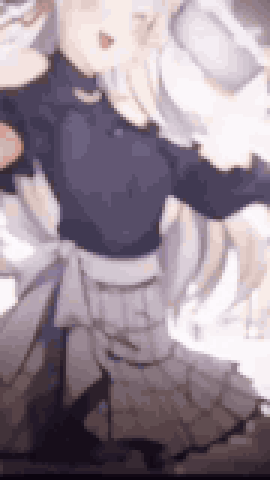

<h1 align="center">Hi, I'm Hari 👋</h1>

  

### 🔧 About
- 🎓 Second-year B.Tech ECE @ Kalasalingam Academy of Research and Education
- 🔬 Focus: VLSI, Embedded Systems, Physical Design
- 🏆 Team Lead, NXP Cup India 2026

### 🛠 Tech

 

### 📊 Stats

  

### 📫 Connect
[LinkedIn](https://www.linkedin.com/in/hari-krishnan-19815a37a) | [Email](mailto:[harikrishnanm02642@gmail.com])
